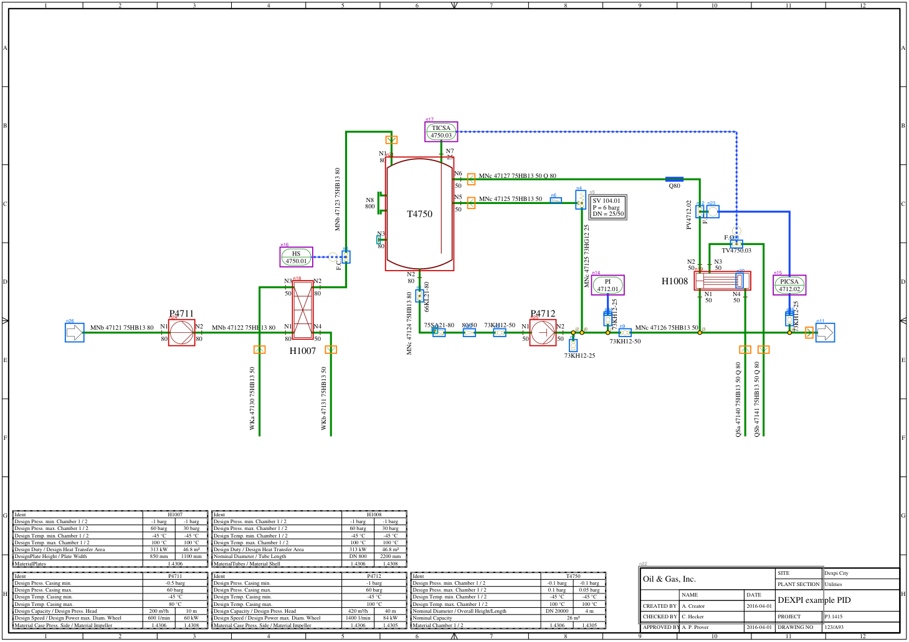
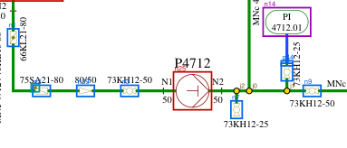

# 예시: 공개 참조 P&ID 한 장을 관계 그래프로 변환

작성 2026-10-29. [v5 구상안](../../docs/concept/v5-기하-요소-그래프-기반-기술-그림-구조화.md)의 1단계(시각 요소 추출)와 2단계(관계 그래프 생성)를 실제 그림 한 장에 적용한 결과. 모델 학습 없이 기하 규칙만으로 처리함.

## 대상 그림

DEXPI 참조 P&ID `C01V04-VER.EX01`. 펌프 2기(P4711, P4712), 열교환기 2기(H1007, H1008), 탱크 1기(T4750), 밸브 11개, 계기 4개, 배관 23구간, 장비 사양표 5개, 표제란이 A3 한 장에 들어 있는 표준 예제임.

| 파일 | 내용 | 용도 |
|---|---|---|
| `input/C01V04-VER.EX01.svg` | 벡터 그림(선, 곡선, 타원, 문자) | 추출 입력 |
| `input/C01V04-VER.EX01.xml` | Proteus XML. 장비, 노즐, 배관 부품, 배관 구간의 연결 정보 | 정답 대조 전용 |

출처: DEXPI 이니셔티브 공개 예제. SVG는 공개 렌더링 도구 저장소(dexpi-render, MIT)의 샘플을 그대로 사용함. 추출 과정에서 XML은 읽지 않음.

입력에서 사용한 정보는 선, 곡선, 타원, 문자의 좌표와 선 굵기, 점선 여부뿐임. SVG의 그룹 이름, 식별자, 기호 정의 이름, 색상은 사용하지 않음. 문서에 들어 있는 벡터 PDF도 같은 요소로 환원되므로 같은 절차를 적용할 수 있음.

## 처리 단계

| 단계 | 규칙 | 결과 |
|---|---|---|
| 요소 읽기 | 경로를 직선, 곡선으로 분해. 변환 행렬 적용 | 직선 463, 곡선 10, 타원 21, 문자 245 |
| 테두리, 표 분리 | 쪽 면적의 80% 이상을 덮는 닫힌 사각형은 테두리. 서로 맞닿은 선이 사각형 경계를 90% 이상 덮고 안에 문자가 6개 이상이면 표 또는 표제란 | 표 5개(각 8행), 표제란 1개. 남은 요소 329, 문자 100 |
| 닫힌 도형 | 끝점이 모두 맞물린 선과 곡선의 묶음, 둘레 12 mm 이상의 타원 | 탱크, 열교환기 몸체, 펌프 원, 계기 원, 주석 상자 |
| 기호 묶음 | 사선, 곡선, 작은 타원을 접점 0.6 mm 기준으로 묶음. 기호에 닿은 짧은 축 평행 직선은 기호의 일부 | 밸브, 리듀서, 안전밸브, 연결기 등 |
| 선 정리 | 축 평행 직선을 같은 축에서 병합. 선 위에 놓인 기호에서 절단. 다른 선의 끝이 닿는 곳은 분기점 | 배관 구간 37, 신호선 7, 분기점 5 |
| 연결 판정 | 선 끝이 0.6 mm 안에서 닿는 요소를 연결로 확정. 선 방향으로 5 mm 안에 요소가 있으면 간격 후보로 표시 | 확정 40, 간격 후보 4 |
| 끝막음, 접속구 | 선 끝에 직각으로 걸린 짧은 선은 끝막음 기호. 장비에서 나온 짧은 토막 끝의 것은 접속구 | 막음 플랜지 2, 접속구 2 |
| 흐름 방향 | 선이 관통하는 꺾쇠 두 선은 화살표. 꼭짓점 방향을 구간에 기록 | 화살표 8 |
| 문자 연결 | 요소 상자 안이나 4 mm 안의 문자는 요소의 라벨. 선 번호 형식이고 선과 평행하면 선의 라벨 | 문자 100개 모두 연결(요소 85, 선 15) |
| 역할 추정 | 장비 태그 형식(영문 1자+숫자 4자리)이면 장비, 계기 기능 문자와 루프 번호가 함께 있으면 계기 | 장비 5, 계기 4, 기호 19, 접속구 2, 주석 2 |



빨강 상자 장비, 파랑 상자 기호, 보라 상자 계기, 초록 선 배관 구간, 파랑 선 신호선, 점선 간격 후보, 노랑 점 분기점, 회색 점선 표.



## 생성된 그래프

노드 64개(장비 5, 계기 4, 기호 19, 접속구 2, 주석 2, 화살표 8, 표시 24), 분기점 5개, 연결 구간 44개. 전체는 [output/graph.json](output/graph.json), 텍스트 직렬화는 [output/graph.txt](output/graph.txt).

직렬화의 일부:

```
n25 종류=equipment 이름=P4712 라벨=P4712|N1|50|N2|50 bbox=(245.8,148.8,256.2,159.2)
r8  종류=pipe A=n3[symbol 73KH12-50] B=n25[equipment P4712] 경로=(233.0,154.0)→(245.8,154.0)
r9  종류=pipe A=n25[equipment P4712] B=j2 경로=(256.2,154.0)→(265.0,154.0)
r13 종류=pipe A=j0 B=n4[symbol SV 104.01] 라벨=MNc 47125 73HG12 25 경로=(269.0,154.0)→(269.0,96.0)
r16 종류=pipe A=n9[symbol 73KH12-50] B=j3 흐름=A→B 라벨=MNc 47126 75HB13 50 경로=(291.0,154.0)→(323.5,154.0)
r23 종류=signal A=n17[instrument TICSA 4750.03] B=n13[symbol TV4750.03] 간격=4.05mm(후보) 경로=(210.8,61.0)→(340.5,61.0)→(340.5,113.0)
```

모든 노드와 구간에 원본 좌표가 붙어 있으므로 답변의 근거 영역을 그림 위에 표시할 수 있음.

## 기존 텍스트 LLM에 전달하는 형태

질문 "P4712 펌프의 토출 측은 어디로 연결되는가"에 대해 P4712에서 배관 연결을 3단계 따라간 부분 그래프만 전달함([output/graph_P4712.txt](output/graph_P4712.txt)).

```
n25[equipment P4712] --r9--> j2 근거=bbox=(245.8,148.8,256.2,159.2) pt=(265.0,154.0)
j2 --r11--> n7[symbol 73KH12-25] 근거=pt=(265.0,154.0) bbox=(264.0,158.0,266.0,162.0)
j2 --r10--> j0 근거=pt=(265.0,154.0) pt=(269.0,154.0)
j0 --r13(MNc 47125 73HG12 25)--> n4[symbol SV 104.01] 근거=pt=(269.0,154.0) bbox=(267.0,89.0,270.0,96.0)
j0 --r12--> j1 근거=pt=(269.0,154.0) pt=(281.0,154.0)
```

이 입력으로 LLM은 "토출 측(N2)은 분기점 j2에서 세 갈래로 나뉨. 아래로 밸브 73KH12-25, 위로 안전밸브 SV 104.01로 가는 선 MNc 47125 73HG12 25, 오른쪽으로 밸브 73KH12-50을 지나 열교환기 H1008 방향"과 같이 답하고 각 항목의 좌표를 근거로 제시할 수 있음. OCR 결과만 주면 "P4712", "73KH12-25", "SV 104.01"이 같은 그림에 있다는 사실까지만 알 수 있음.

## 정답 대조

정답은 XML의 배관 구간 연결(Connection)과 구간 안의 부품 순서로 만든 인접 쌍 27개. 노즐은 소속 장비로 합침. 세부는 [output/eval.md](output/eval.md).

| 항목 | 결과 |
|---|---|
| 정답 인접 쌍 복원 | 27개 중 27개 |
| 추출 인접 쌍 | 34개. 정답에 없는 7개 중 6개는 계기 신호선 연결(정답 범위 밖), 1개는 밸브와 구동부 원의 연결(그림에는 있으나 배관 정답에는 없음) |
| 요소 라벨 소속 | 62개 중 60개. 누락 2개는 탱크 N8 접속구의 "N8", "800" |
| 선 라벨 | 선 번호 11개 모두 해당 배관 구간에 연결 |
| 표 | 장비 사양표 5개를 행 단위로 분리 |

## 한계와 다음 단계

- 기호 종류를 분류하지 않음. 밸브 종류, 펌프 종류는 라벨 문자에 의존함. 기호 범례에서 추출한 형상과의 대조나 소형 분류기가 필요함
- 임계값(접점 0.6 mm, 긴 선 6 mm, 간격 후보 5 mm, 문자 4 mm)은 이 도면의 축척에 맞춘 값임. 여러 도면에서 축척에 따라 자동 조정하는 규칙이 필요함
- 스캔 래스터 입력은 실험하지 않음. 벡터화와 OCR을 거친 뒤 같은 절차를 적용하는 것이 다음 단계임
- 흐름 방향은 화살표가 있는 8개 구간에만 있음
- 한 장에 대한 결과이므로 PID2Graph 같은 공개 도면 묶음으로 재현율과 정밀도를 다시 측정해야 함

## 재현

```
pip install -r requirements.txt
python extract_graph.py input/C01V04-VER.EX01.svg output/graph
python evaluate.py output/graph.json input/C01V04-VER.EX01.xml output/eval.md
python serialize.py output/graph.json output/graph.txt P4712
python render.py input/C01V04-VER.EX01.svg output/graph.json output/overlay.png
```
