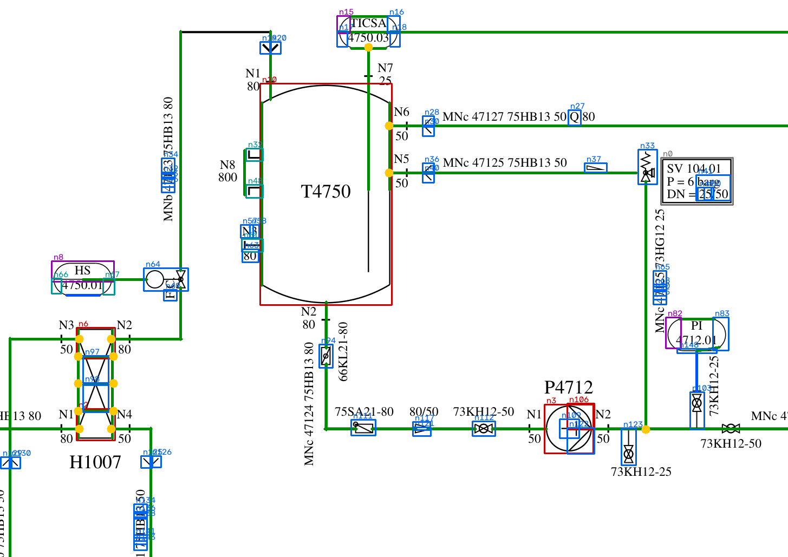
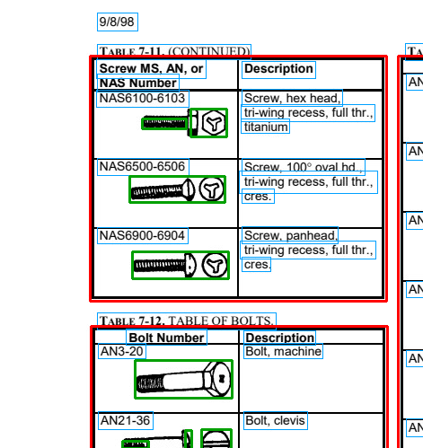
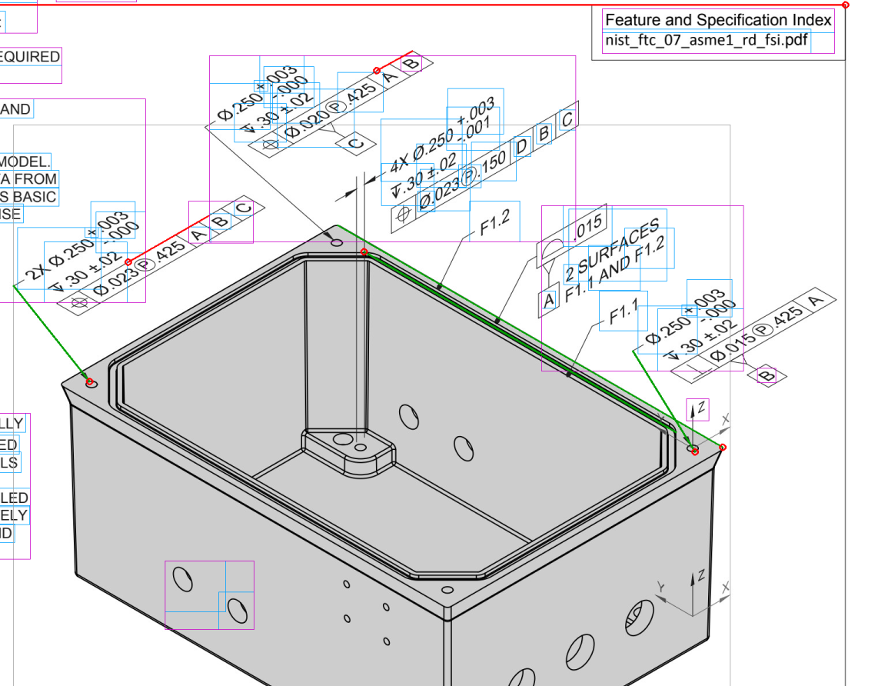

# 공개 도면·실제 문서로 확인한 추출 성능

작성 2026-10-29. [DEXPI 참조 P&ID 한 장 예시](../dexpi-reference-pid/README.md)의 추출 규칙을 공개 도면 5장과 실제 정비 문서 10쪽에 적용하고, 벡터 원본·래스터 변환·스캔 열화의 세 조건에서 결과를 대조함. 모든 처리는 CPU 1대, 공개 도구(OCR 모델 1종, 영상 처리 라이브러리)로 수행하며 생성형 모델은 쓰지 않음. 폐쇄망·제한 GPU 환경을 가정한 조건임.

## 1. 자료

| 구분 | 자료 | 정답 | 형식 |
|---|---|---|---|
| P&ID | DEXPI 참조 도면 C01, C02, C03 | Proteus XML의 배관 연결 | 벡터(자체 변환기로 XML을 SVG로 렌더링) |
| P&ID | 증류 공정 2건(공개 변환 도구 저장소의 예제, 플랜트·실험실) | Proteus XML의 배관 연결 | 벡터(같은 변환기). 문자 없음 |
| 정비 지침 | FAA AC 43.13-1B 7장 6쪽(토크 표, 본문, 볼트 표) | 없음. 표본 육안 대조 | 약 100 dpi 래스터, 스캔 1쪽은 200 dpi |
| 치수·공차 도면 | NIST PMI 시험 모형 FTC 06~08 | 없음. 표본 육안 대조 | 200 dpi 래스터 |

Proteus XML은 기호 형상 목록과 배치(위치·회전·축척)로 그림을 정의하므로 자체 변환기(`pid/proteus_to_svg.py`)로 선·곡선·타원·문자만 있는 SVG를 만들고, 그 SVG에서 추출함. 변환기 검증: 공개 렌더링 도구의 C01 SVG와 자체 변환 C01 SVG의 추출 결과가 같음(정답 쌍 27/27).

래스터 조건은 SVG를 200 dpi(증류 플랜트는 150 dpi)로 그린 PNG. 스캔 조건은 그 PNG에 0.4도 회전, 흐림, 잡음, JPEG 압축(품질 45)을 더한 영상.

## 2. P&ID: 정답 대조 결과

정답은 XML의 배관 연결과 구간 안 부품 순서로 만든 인접 쌍. 노즐은 소속 장비로 합침. '병합'은 두 정답 요소가 한 노드로 묶인 경우, '통과'는 기호 없이 선 위 표식으로 그려진 부품을 지나친 경우. 추출 쌍 중 정답에 없는 것은 계측 신호선 연결(정답 범위 밖)과 오류로 나눔.

### 벡터 원본

| 도면 | 정답 쌍 | 복원 | 병합 | 통과 | 오류 쌍 | 신호선 쌍 | 요소 라벨 | 처리 시간 |
|---|---|---|---|---|---|---|---|---|
| C01 | 27 | 27 | 0 | 0 | 0 | 6 | 60/62 | 0.7초 |
| C02 | 6 | 3 | 2 | 2 | 10 | 4 | 35/61 | 1초 미만 |
| C03 | 9 | 4 | 1 | 0 | 5 | 5 | 4/4 | 1초 미만 |
| 증류 플랜트 | 157 | 84 | 22 | 33 | 49 | 54 | 문자 없음 | 10.6초 |
| 증류 실험실 | 25(8 제외) | 9 | 3 | 1 | 16 | 26 | 문자 없음 | 1.2초 |

증류 실험실의 제외 8쌍은 기호가 없는 장비(XML에 있고 그림에 없음) 4개와 관련된 쌍.

### 래스터(200 dpi)와 스캔 열화

| 도면 | 조건 | 정답 쌍 | 복원 | 병합 | 통과 | 오류 쌍 | 신호선 쌍 | 요소 라벨 | OCR | 선·기호 | 그래프 |
|---|---|---|---|---|---|---|---|---|---|---|---|
| C01 | 래스터 | 26 | 14 | 5 | 1 | 52 | 5 | 15/40 | 39초 | 7초 | 1초 |
| C01 | 스캔 | 23 | 10 | 3 | 4 | 194 | 216 | 7/25 | 42초 | 18초 | 6초 |
| C02 | 래스터 | 10 | 1 | 2 | 0 | 33 | 25 | 9/26 | 31초 | 3초 | 1초 미만 |
| C03 | 래스터 | 9 | 2 | 1 | 0 | 12 | 14 | 2/2 | 22초 | 1초 미만 | 1초 미만 |
| 증류 플랜트 | 래스터 150 dpi | 163 | 26 | 30 | 26 | 275 | 227 | 문자 없음 | 29초 | 52초 | 13초 |

정답 쌍 수가 조건마다 다른 것은 어느 요소가 노드로 잡혔는지에 따라 병합·통과 판정이 달라지기 때문임.

빨강 상자 장비, 파랑 상자 기호, 보라 상자 계기, 초록 선 배관, 파랑 선 신호선, 노랑 점 분기점.

### 원인

| 현상 | 원인 | 대응 |
|---|---|---|
| 벡터 C02·C03 복원 절반 | 컬럼 몸체의 긴 직선 변이 배관으로 분류되고 내부 구획선이 몸체를 여러 노드로 나눔. 플랜지가 선 위 짧은 표식으로 그려짐 | 장비 윤곽 안의 선은 배관 후보에서 제외. 표식 부품은 통과 처리 |
| 증류 플랜트 복원 0.54 | 작성 도구가 배관 끝을 기호에서 5 mm 떨어뜨려 저장. 컬럼 노드 하나가 주변 부품 9개를 흡수 | 간격 허용치를 도면의 지배적 선 굵기에 비례해 조정(일부 회복). 큰 장비의 흡수는 미해결 |
| 래스터 C01 복원 0.54, 벡터 1.0 | 선 굵기 측정 오차 1픽셀(0.13 mm)로 배관과 신호선 구분이 흔들림(0.25 mm 대 0.2 mm 선은 200 dpi에서 구분 불가). 문자 지운 자리와 기호 경계에서 선이 끊김. 계기 원이 선에 의해 반원 두 개로 나뉨 | 신호선 판정은 점선 여부 위주로. 틀 눈금·표제란 칸은 '직선으로 둘러싸인 빈 칸' 규칙으로 제거(초기 결과의 장비 오탐 59개가 11개로 감소) |
| 스캔 열화 | 0.4도 기울기에서 축 평행 선이 계단 모양으로 끊겨 긴 선 탐지가 실패하고(보정 전 오류 쌍 413), 잡음 알갱이가 표식·기호로 잡힘. 보정 후에도 세로 라벨이 여러 조각으로 쪼개지고 신호선 오분류가 남음(오류 쌍 194, 신호선 쌍 216) | 기울기 보정(긴 선 각도 중앙값)과 중앙값 필터를 전처리로 추가 |
| 래스터 증류 플랜트 | 벡터에서 이미 있던 5 mm 간격에 래스터 선 끊김이 더해져 구간이 잘게 쪼개짐(추출 쌍 528) | 벡터 원본 확보가 우선 |

### 결론

벡터 원본이 있으면 표준 기호로 그린 도면(C01)은 연결 관계를 전부 복원함. 작성 도구의 저장 습관(간격, 표식 부품, 기호 없는 장비)이 다른 도면은 규칙 보정이 필요함. 래스터는 같은 도면에서 복원율이 절반으로 떨어지고 오류 쌍이 늘어나므로, 실무에서는 벡터 PDF·CAD 원본 확보를 먼저 하고 스캔은 사람이 검토하는 보조 경로로 두는 것이 맞음.

## 3. 실제 문서 쪽: 표·삽화·지시선

정답이 없으므로 추출 개수·시간과 표본 육안 대조로 기록함.

### FAA AC 43.13-1B 7장(하드웨어)

| 쪽 | 내용 | OCR 문자 | 평균 신뢰도 | 표 | 칸 | 그림 영역 | 그림이 든 행 |
|---|---|---|---|---|---|---|---|
| 7-9 | 토크 표 7-1 | 209 | 0.89 | 1 | 66 | 0 | 0 |
| 7-10 | 본문(도금, 윤활) | 144 | 0.79 | 0 | 0 | 0 | 0 |
| 7-11 | 최소 체결 토크 표 7-2, 본문 | 153 | 0.77 | 1 | 66 | 2 | 1 |
| 7-13 | 본문(너트) | 72 | 0.81 | 0 | 0 | 0 | 0 |
| 7-16 | 나사 표 7-11, 볼트 표 7-12 | 83 | 0.76 | 3 | 72 | 29 | 20 |
| 7-17 | 볼트 표 7-12(계속) | 102 | 0.7 | 2 | 72 | 44 | 22 |
| 7-9 스캔 | 토크 표 7-1, 200 dpi 스캔 | 218 | 0.9 | 1 | 24 | 2 | 1 |

볼트 표(7-16, 7-17)는 행마다 삽화·부품 번호·설명 칸으로 이루어져 '그림과 문자의 관계'가 표 행으로 드러나는 자료임. 격자선으로 칸을 나누고 문자·격자 밖 잉크 덩어리를 그림 영역으로 보아 같은 행의 부품 번호·설명과 묶음.

빨강 표 영역, 초록 행에 묶인 그림 영역, 파랑 OCR 문자.

표본 육안 대조(7-16 볼트 표 자료 행 21개): 삽화가 행에 묶인 것 20개, 부품 번호 문자열이 정확한 것 17개(오류 4개는 O와 0, 1과 O, 대소문자 혼동), 설명 칸은 전부 해당 행에 들어갔으나 'Bolt'가 'Boll'로 읽힌 경우 다수).

토크 표 7-1은 행 구분선이 없어 머리글 아래 본문이 한 칸으로 잡힘. 행 분리는 문자 줄 간격 기준의 추가 규칙이 필요함. 100 dpi 원본의 OCR은 부품 번호의 O/0, l/1 혼동이 잦음(예 NAS65O0, AN1O1001).

### NIST PMI 시험 모형 도면

| 쪽 | OCR 문자 | 주기 상자 | 지시선이 붙은 주기 | 끝점이 부품 위 | 선 조각 | OCR | 구조 |
|---|---|---|---|---|---|---|---|
| FTC 06 | 85(신뢰도 0.69) | 23 | 16 | 10 | 358 | 33초 | 0.1초 |
| FTC 07 | 96(신뢰도 0.76) | 20 | 10 | 4 | 300 | 31초 | 0.1초 |
| FTC 08 | 78(신뢰도 0.75) | 20 | 12 | 3 | 258 | 31초 | 0.1초 |

주기 상자는 2 mm 안에서 이어지는 문자 상자의 묶음. 지시선은 한 끝이 주기 상자 3 mm 안에 있고 다른 끝이 5 mm 이상 떨어진 직선 조각.

보라 상자 주기, 초록 선 끝점이 부품 위인 지시선, 빨강 선 그 밖의 지시선 후보.

표본 육안 대조(FTC 07, 지시선이 붙은 주기 10개): 올바른 연결 1개(왼쪽 위 구멍 지름 주기와 윗면 구멍). 나머지는 부품 모서리선이나 쪽 틀 선을 지시선으로 잡음. 원인은 세 가지임. 등각 투상도의 주기가 30도 안팎으로 기울어 있어 문자 상자가 글자 단위로 쪼개지고 2 mm 묶음 규칙이 이웃 주기까지 합침(주기 20개 중 실제 기하 공차 틀은 약 12개). 음영 처리된 부품 면과 모서리선이 잉크로 잡혀 직선 조각(300개 안팎)의 대부분이 부품 윤곽임. 지시선 끝의 화살표·점을 구분하지 않음. 치수·공차 도면은 PDF의 선 요소를 직접 읽는 벡터 경로가 맞고, 래스터 경로는 회전 문자 OCR과 지시선·윤곽선 분리가 추가 과제임.

### 처리 시간(CPU 1대, 단독 실행)

| 작업 | 입력 | OCR | 선·기호·표 | 그래프 | 전체 |
|---|---|---|---|---|---|
| P&ID C01 래스터 | A3, 200 dpi(3308×2339) | 44초 | 19초 | 1초 | 64초 |
| P&ID C01 스캔 | 같음 | 42초 | 17초 | 5초 | 64초 |
| 볼트 표 7-16 | 레터, 100 dpi(857×1109) | 20초 | 1초 미만 | 없음 | 21초 |
| 토크 표 7-9 스캔 | 레터, 200 dpi(1700×2200) | 41초 | 1초 미만 | 없음 | 43초 |
| NIST FTC 07 | 레터 가로, 200 dpi(2200×1700) | 30초 | 1초 미만 | 없음 | 32초 |

OCR 모델 적재 약 7초는 제외. 벡터 경로는 C01 0.7초, 증류 플랜트 10.6초로 OCR이 없는 만큼 수십 배 빠름. 쪽당 1분 안팎이면 수천 쪽 문서도 CPU 1대로 하루 안에 처리할 수 있으나, 래스터 경로의 정확도가 낮아 결과 검토 인력이 병목임.

## 4. 실제 문서의 형식 조사

항공 정비·제조 문서에서 그림이 들어가는 형식을 공개 자료로 확인한 결과.

| 문서 | 형식 | 그림과 문자의 관계 | 출처 |
|---|---|---|---|
| S1000D 기술 간행물 삽화 | CGM 벡터(1990년대부터 표준). 스캔 원본(TIFF·JPEG)은 CGM으로 변환해 수록 | 삽화 안의 지시 번호와 그래픽 요소에 핫스팟(hotspot)을 두고 부품 목록 항목과 연결 | S1000D Illustrations Whitepaper v2.0(2016) |
| S1000D 배선 도해 교범(WDM) | 데이터 모듈마다 선 도해 하나와 장비 표·전선 표 | 전선 번호·장비 번호가 도해와 표를 잇는 고유 색인. 쪽 사이 연결은 SNS 참조 | Chen 외, ATDE 2026 |
| FAA AC 43.13-1B 7장(하드웨어) | 스캔 PDF 약 100 dpi | 토크 표·볼트 표. 볼트 표는 행마다 삽화·부품 번호·설명 칸 | FAA 공개본 |
| NIST PMI 시험 모형 도면 FTC 06~11 | PDF 도면 200 dpi 래스터화 | 등각 투상도에 치수·기하 공차 주기와 지시선. 주기(note) 목록은 왼쪽 문자 영역 | NIST MBE PMI Validation and Conformance Testing |
| DEXPI 참조 P&ID C01~C03, 증류 공정 2건 | Proteus XML(기호·연결 정보 포함)과 벡터 그림 | 배관 구간의 연결(Connection)이 정답 | DEXPI 공개 예제, 공개 변환 도구 저장소 |

결론: 산업 현장의 그림 문서는 벡터 원본이 있으면 요소 좌표와 연결 정보가 이미 구조화되어 있고(CGM 핫스팟, Proteus 연결), 없으면 스캔 래스터에서 문자·선·기호를 복원해야 함. 두 경로 모두 지원해야 하며 래스터 경로의 품질이 실무 적용의 한계를 정함.

## 5. 한계

- 정답이 있는 자료는 P&ID 5장뿐이고 그중 표준 기호 도면은 1장. 정비 문서·치수 도면은 표본 육안 대조임.
- 기호 분류(밸브 종류 등)는 하지 않음. 연결 관계와 라벨 소속을 평가함.
- 임계값(선 길이 6 mm, 접점 0.6 mm 등)은 A3 도면 축척 기준. 다른 축척은 조정 필요.
- OCR 모델은 영문 전용으로 실행함. 한글 혼용 문서는 다국어 모델이 필요함.

## 6. 파일

| 경로 | 내용 |
|---|---|
| `pid/proteus_to_svg.py` | Proteus XML을 선·곡선·타원·문자 SVG로 변환 |
| `pid/extract_graph.py`, `evaluate.py`, `serialize.py`, `render.py` | 벡터 추출·정답 대조·직렬화·그림(한 장 예시의 개정판) |
| `pid/raster_graph.py`, `render_raster.py`, `make_scan.py` | 래스터 추출(OCR, 형태학 선 탐지, 구멍 윤곽, 기울기 보정), 그림, 스캔 열화 생성 |
| `pid/input/` | XML 5건과 변환 SVG |
| `pid/output/vector/`, `raster/`, `scan/` | 조건별 대조표(`*-eval.md`)와 그림 |
| `pages/real_docs.py` | 표 모드(격자·칸·그림 영역)와 도면 모드(주기 상자·지시선) |
| `pages/input/`, `pages/output/` | 원본 쪽 영상(미국 정부 공개 자료)과 결과 JSON·그림 |
